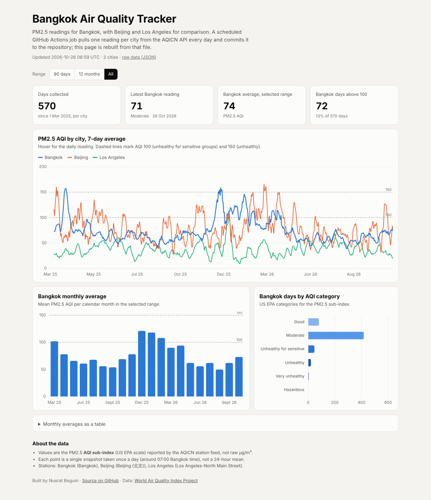

# Bangkok Air Quality Tracker

**Live dashboard:** https://bangkok-air-quality.vercel.app

A small data pipeline and dashboard for PM2.5 in Bangkok, with Beijing and Los Angeles for comparison. A scheduled GitHub Actions job has pulled one reading per city from the AQICN API each day since **1 March 2025** and committed it to this repository: 570 daily readings per city so far, with one 35-day gap (15 Jan – 18 Feb 2026) when the job did not run. A static dashboard is rebuilt from that file and deployed on every push.

It started as the final project for *Data Science Essentials* at Mahidol University (MUICT), built by a team of two, and has kept collecting data since.



## What it does

```
GitHub Actions (daily cron, 00:00 UTC)
  └─ fetch_airdata.py          → AQICN API → appends 3 rows to air_data.csv
  └─ scripts/build_dashboard.py → air_data.csv → dashboard/data.json
  └─ git commit + push         → Vercel redeploys dashboard/
```

- **Collection:** `fetch_airdata.py` calls the AQICN city feed for each city and appends the AQI, the PM2.5 sub-index and the raw JSON response (temperature, humidity, wind, forecasts) to `air_data.csv`. The API key is read from the `AQICN_API_KEY` environment variable / repository secret.
- **Transform:** `scripts/build_dashboard.py` parses the CSV (stdlib only), keeps one reading per city per day, and writes a compact `dashboard/data.json`.
- **Dashboard:** `dashboard/index.html` is a static page with Chart.js: 7-calendar-day average lines per city (gaps shown as breaks) with daily values on hover, a daily table view, Bangkok monthly averages, days per US EPA AQI category, a time-range filter, a table view, and light/dark themes.
- **Analysis:** `main.ipynb` holds the original course analysis (see below).

## Data notes

- Values are the **PM2.5 AQI sub-index (US EPA scale)** from the AQICN station feed, not raw µg/m³.
- Collection gap: no data from 15 Jan to 18 Feb 2026. The dashboard shows it as a break in the lines.
- Each point is one snapshot per day, taken in the Bangkok morning (the job is scheduled for 07:00 local time and GitHub may start it later), not a 24-hour mean.
- Stations: Bangkok (city feed), Beijing (city feed), Los Angeles (North Main Street).

## Course analysis and results

The notebook tested two hypotheses on Bangkok data from March–April 2025 (47 days, joined with Open-Meteo weather):

| Hypothesis | Test | Result |
|---|---|---|
| H1: PM2.5 is higher on low-wind (< 64 km/h) and high-humidity (> 70%) days | One-tailed Welch t-test; Mann–Whitney U | **Not supported.** Mean 79.7 on those days (n = 34) vs 109.4 on other days (n = 13); p = 0.98 (t-test), p = 0.99 (Mann–Whitney). |
| H2: PM2.5 differs between rainy and dry days | Two-tailed Welch t-test; Mann–Whitney U | **Not significant.** Mean 81.9 on rainy days (n = 28) vs 96.8 on dry days (n = 19); p = 0.14 (t-test), p = 0.29 (Mann–Whitney). |

Linear regressions on the same features had negative mean 5-fold cross-validated R² (−1.57 and −1.87), so weather alone did not predict PM2.5 in that window. The small sample (47 days, one season) is the main limitation. The daily collection that continues in this repo, now 570 days, is the dataset a follow-up analysis would use.

## Run it locally

```bash
pip install -r requirements.txt

# collect today's readings (needs a free key from https://aqicn.org/data-platform/token/)
export AQICN_API_KEY="your_key"
python fetch_airdata.py

# rebuild the dashboard data and open it
python scripts/build_dashboard.py
python -m http.server -d dashboard 8000   # then visit http://localhost:8000
```

## Project structure

```
.
├── .github/workflows/main.yml   # daily collection + dashboard data rebuild
├── fetch_airdata.py             # AQICN API client → air_data.csv
├── read_airdata.py              # quick look at the collected CSV
├── scripts/build_dashboard.py   # air_data.csv → dashboard/data.json
├── dashboard/                   # static dashboard served by Vercel
│   ├── index.html
│   └── data.json
├── air_data.csv                 # collected data (appended daily)
├── main.ipynb                   # course analysis
├── docs/dashboard.png
└── vercel.json
```

## Authors

- Nusrat Begum ([GitHub](https://github.com/NusratBegum) · [nusratbegum.dev](https://nusratbegum.dev)) and Liam: course project authors
- Nusrat Begum maintains the daily collection and the dashboard

## Acknowledgments

Data from the [World Air Quality Index Project](https://aqicn.org/) and [Open-Meteo](https://open-meteo.com/). Course: Data Science Essentials, Faculty of ICT, Mahidol University.
